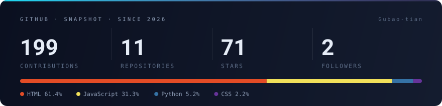
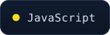
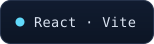
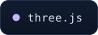
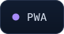

<!--
  Profile README — github.com/Gubao-tian
  All visuals are generated, not hand-drawn:
    node tools/build-assets.mjs    -> assets/hero-*.svg, assets/badges/*.svg
    node tools/generate-stats.mjs  -> assets/stats-*.svg  (daily via Actions)
  The content below is curated from the public repositories on this account.
  Keep prose free of hard-coded counts: the stats card is the single source of truth.
-->

<picture>
  <source media="(prefers-color-scheme: dark)" srcset="assets/hero-dark.svg">
  <source media="(prefers-color-scheme: light)" srcset="assets/hero-light.svg">
  
</picture>

### Hi, I'm Gubao-tian 👋

I ship **small, finished, verifiable software** — and I publish the working notes with it.

Most of my repositories are self-contained web apps with no build step, no CDN and no
`npm install`: double-click `index.html` and they run offline. The rest are LLM application
engineering and computer-vision projects that come with the PRD, API contract, tests and
acceptance criteria behind them. [Browse all repositories →](https://github.com/Gubao-tian?tab=repositories)

> The rule I keep: **if it cannot be demonstrated, it does not go in the README.**

---

### 🧭 What I actually build

| | |
| :--- | :--- |
| **📦 Zero-dependency delivery** | Single-file HTML / PWA / Canvas apps, vendored `three.js`, offline by default. A file you can hand to someone and it just runs. |
| **📐 Docs-first engineering** | PRD → ADR + frozen API contract → implementation → tests → acceptance list. Every claim stays traceable to a document or a test. |
| **🔬 Evidence over adjectives** | Controlled E1–E4 experiments, 103 unittests, 165 offline assertions, 6 × 240 km simulations, load tests, before/after comparisons. |

---

### 🧩 Selected work

#### 🤖 LLM application engineering

| Repository | Why it is here |
| :--- | :--- |
| **[简历润笔 · ResumePolish](https://github.com/Gubao-tian/resumepolish)** · `React` `Vite` `Node` `LLM API` | JD-aligned rewrite of a single CV bullet. Every edit carries a reason; seven server-side guards reject invented facts or numbers. Mock mode is a first-class citizen — rate limits and validation stay real. |
| **[ResumePolish PRD V1.0](https://github.com/Gubao-tian/resume-optimizer-prd)** · `Product spec` | The spec behind the app: five-role research, goals / non-goals, 20 PM rulings, acceptance gates and a delivery record. Read this first if you care about *why*, not just *what*. |

#### 👁️ Computer & industrial vision

| Repository | Why it is here |
| :--- | :--- |
| **[yolo-starter](https://github.com/Gubao-tian/yolo-starter)** · `Python` `Ultralytics` `Flask` | YOLOv8 detection of 6 campus-waste classes. Offline HTML dashboard, E1–E4 controlled experiments on resolution / confidence, 103 unittests, a five-minute walkthrough, and a real-inference photo-upload mode. |
| **[工业镜头选型工具](https://github.com/Gubao-tian/machine-vision-lens-selector)** · `HTML` `JS` `Optics` | FOV + accuracy → required sensor resolution via the 3-pixel rule, then focal length, depth of field, telecentricity criteria and hard constraint filters, ending in a client-ready spec. The calculation engine has unit tests. |

#### 🌐 Offline-first web products

| Repository | Why it is here |
| :--- | :--- |
| **[小宝工作台 · MY COZY DESK](https://github.com/Gubao-tian/xiaobao-desk)** · `HTML` `JS` `PWA` | 16-module personal workbench: lunar calendar (1900–2100 with solar-term astronomy), heatmaps, automatic growth reports, JSON backup, Service Worker offline support, and a `.spec/` static + regression suite. |
| **[故宫 · 中轴线 3D](https://github.com/Gubao-tian/forbidden-city-3d)** · `three.js` `JS` | Procedural reconstruction of the Forbidden City axis: 31 walled courtyards, lofted hip roofs, ridge beasts, seasons, day/night cycle. No model files, no textures, no bundler. [Live →](https://gubao-tian.github.io/forbidden-city-3d/) |
| **[情绪减压舱](https://github.com/Gubao-tian/qingxu-jianyacang)** · `HTML` `JS` | 11 emotions / 9 scenarios → an "empathy → reframe → action" plan, sharable cards, 14-day trend and 4-7-8 breathing. Everything stays in `localStorage`; nothing is uploaded. |
| **[大学生该做的 100 件事](https://github.com/Gubao-tian/college-100-things)** · `HTML` `Pages` | Cream-paper journal checklist: photo records, six progress chapters, keyword cloud, and an offline fallback when the cloud is unreachable. [Live →](https://gubao-tian.github.io/college-100-things/) |
| **[轨道无限跑酷 · Rail Runner](https://github.com/Gubao-tian/rail-runner)** · `Canvas` `JS` | Three-lane runner with a documented seven-state FSM, deterministic level generation and death attribution; verified by 165 offline assertions and 6 × 240 km simulations. [Play →](https://gubao-tian.github.io/rail-runner/) |
| **[TCP 调试助手](https://github.com/Gubao-tian/tcp-debug-assistant)** · `Node` `SSE` | Browser UI bridged to a Node `net` backend: client / server modes, HEX, auto-reconnect, per-connection tabs, traffic stats. Zero third-party dependencies. |

The remaining repository is this profile itself — its banner, badges and stats are generated by scripts in [`tools/`](tools/).

---

### 📊 GitHub, in numbers

<picture>
  <source media="(prefers-color-scheme: dark)" srcset="assets/stats-dark.svg">
  <source media="(prefers-color-scheme: light)" srcset="assets/stats-light.svg">
  
</picture>

Queried from the GitHub GraphQL API and re-rendered daily by [a scheduled Action](.github/workflows/profile-stats.yml) — no third-party image service, nothing that can go down. The language bar is measured from repository bytes, not self-reported.

<!--
  Contribution snake: .github/workflows/snake.yml publishes snake-{dark,light}.svg
  to the `output` branch daily. Uncomment once the contribution grid is dense
  enough for the animation to read well.

<picture>
  <source media="(prefers-color-scheme: dark)" srcset="https://raw.githubusercontent.com/Gubao-tian/Gubao-tian/output/snake-dark.svg">
  <source media="(prefers-color-scheme: light)" srcset="https://raw.githubusercontent.com/Gubao-tian/Gubao-tian/output/snake-light.svg">
  
</picture>
-->

---

### 🧰 Stack

Read off the repositories above, not off a wishlist.

**Core** ·    

**AI / Vision** ·   

**Platform & practice** ·      

---

### 📬 Let's connect

- 📫 **936918302@qq.com** — the fastest way to reach me
- 🐙 **[@Gubao-tian](https://github.com/Gubao-tian)** — issues, discussions and PRs are welcome

<b>中文简介 · 展开阅读</b>

 

学生 / 开发者，习惯边做边学，也习惯把做过的事讲清楚。这个账号下的项目大致分三条线：

1. **零依赖的 Web 小产品**：单文件 HTML / PWA，双击即用、离线可跑 —— 小宝工作台、情绪减压舱、大学生该做的 100 件事、故宫中轴线 3D、轨道无限跑酷、TCP 调试助手。
2. **AI 应用工程**：简历润笔从 PRD、技术设计、冻结版 API 契约到服务端七道输出校验，把「零虚构」做成可验证的约束，而不是一句口号。
3. **计算机 / 工业视觉**：YOLOv8 垃圾分类做受控实验并自动给出结论；镜头选型工具把 3 像素准则、薄透镜、景深与远心判据写成可测试的计算引擎。

共同点是：**先写清楚怎么算、怎么验，再写实现；能跑、能看、能复述，才算交付。**

主页的横幅、徽章与统计卡都由仓库内脚本生成（`tools/*.mjs` + 每日 GitHub Actions），
不依赖任何第三方图片服务；统计数字直接取自 GitHub GraphQL API。

- 📫 邮箱：936918302@qq.com
- 🐙 GitHub：[@Gubao-tian](https://github.com/Gubao-tian)

 

Banner, badges and stats are drawn from <a href="tools/build-assets.mjs"><code>tools/build-assets.mjs</code></a> and <a href="tools/generate-stats.mjs"><code>tools/generate-stats.mjs</code></a> — no shields.io, no vercel, nothing that can go down.
