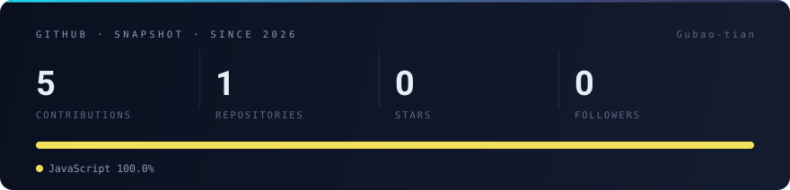

<!--
  Profile README — github.com/Gubao-tian
  Visuals are generated, not hand-drawn:
    node tools/build-assets.mjs      -> assets/hero-*.svg, assets/badges/*.svg
    node tools/generate-stats.mjs    -> assets/stats-*.svg  (runs daily in Actions)
  Regenerate after editing tools/*.mjs and commit the output.
-->

<picture>
  <source media="(prefers-color-scheme: dark)" srcset="assets/hero-dark.svg">
  <source media="(prefers-color-scheme: light)" srcset="assets/hero-light.svg">
  
</picture>

### Hi, I'm Gubao-tian 👋

Student and developer, learning in public. My focus is **Python** and the practical side of
**large language models** — prompts, agents, retrieval, evaluation, and the small tools that turn
a model into something people can actually use.

I'd rather ship a small honest thing than describe a big imaginary one, so this page doubles as
my build log: everything here is generated from the repositories I push.

<table>
<tr>
<td valign="top" width="52%">

**🔭 Now**

- Building my first public repositories — this profile is day one
- Going deeper on LLM application engineering: agents · RAG · evaluation
- Writing Python daily, shipping end-to-end rather than half-finished

</td>
<td valign="top">

**🧰 Toolbox**

</td>
</tr>
</table>

### GitHub, in numbers

<picture>
  <source media="(prefers-color-scheme: dark)" srcset="assets/stats-dark.svg">
  <source media="(prefers-color-scheme: light)" srcset="assets/stats-light.svg">
  
</picture>

Recomputed every day by a GitHub Action — the numbers above are never stale.

### Let's connect

- 📫 **936918302@qq.com** — the fastest way to reach me
- 🐙 **[@Gubao-tian](https://github.com/Gubao-tian)** — issues and discussions are welcome

<b>中文简介</b>

 

学生 / 开发者，习惯边做边学。目前专注 **Python** 与 **大语言模型应用**：提示词、智能体、检索、
评测，以及把这些能力做成真正能用的小工具。

这个主页的横幅、徽章和统计卡都由仓库里的脚本生成（`tools/*.mjs` + GitHub Actions），
不依赖任何第三方图片服务，所以加载稳定，数据和仓库同步更新。

- 📫 邮箱：936918302@qq.com
- 🐙 GitHub：[@Gubao-tian](https://github.com/Gubao-tian)

 

Banner, badges and stats are drawn from <a href="tools/build-assets.mjs"><code>tools/build-assets.mjs</code></a> and <a href="tools/generate-stats.mjs"><code>tools/generate-stats.mjs</code></a> — no shields.io, no vercel, nothing that can go down.
